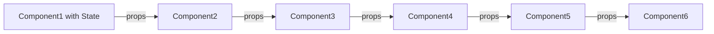
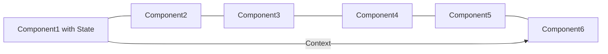

# 

**Learning Objective:** By the end of this lesson, the learner will be able to understand how and when to use useContext and the pros and cons for doing so.

## What is useContext? 

`useContext` is a hook that allows a React application to easily get or set a state without the need to prop or lift the states involved.

## ### Why & when to use Context?

A good analogy of Context vs Props is when we shop online. Props is like buying a product from a retailer instead of the manufactures. Doing so adds one more step and additional overhead/cost to the whole process. However Context is like buying the product directly from the manufacturer.

`useContext` is one of the `3 Basic Hooks` that are included with [React v16.8](https://reactjs.org/blog/2019/02/06/react-v16.8.0.html) and, along with `useState` and `useEffect`, can be used to build a full React application.

## Where Does State Go?

As we've covered before, React has a unidirectional data flow, passing props from parents to children. Components that manage their own state will often pass this information down as props child components.

As apps grow, the `tree of components` grows with it. Soon the decision to create additional state may require that you pass pass and/or lift state further and farther in the React hierarchy then needed.

How would you answer the following question:

---

:question: **Where should you store and manage single or multiple instances of state in the app?**

---

There are a lot of ways to answer this question - ultimately, it comes down to your own understanding of the app, and your preferences as a developer. But, a generic way to answer this question would be:

Answer

**Manage state in the nearest "ancestor" of the components that need to use it**.

### App-level state

We discussed this briefly when we covered _lifting state_ - when we had two sibling components that needed to share some state, we "lifted" the state up to the parent component.

But, there are times where pieces of state need to be used across the entire app. For instance:

- When many views & UI components need to know who the currently logged-in user is.
- When all UI components need to know if the app is in "light" or "dark" mode.

This is _one_ of the times when Context can be useful: when you need to _manage app-level state_.

### Avoiding Prop Drilling

So far, we have been passing props down from parent to child components. In most instances, this is the best way to handle sharing information between components as it keeps this information localized to the parts of your tree that need it.

But, as your tree grows, you'll find yourself passing props down through multiple levels. In the example below sending a single value of state all the way down to the the last child requires passing it down as props through every intermediary Component in the hierarchy.

<!--  -->

#### Use useContent

A much better way would be to provide access to state at a global level and have the child Component access it directly.

<!--  -->

#### Summary: When & Why to use Context

So the two main reasons we should make use of useContext are:

- Avoiding Prop Drilling
- Managing App-level state

## Context Provider and Consumer Model

When using Context, you'll be dealing with a _Provider_ component and _Consumer_ components.

_Providers_ are components that exist higher up on the tree, sending - or _providing_ - information to other components that are further down. This component must wrap the parts of the tree that it will be communicating with.

_Consumers_ are components that receive - or _consume_ - information from their Provider ancestor. Consumer components use the _function as a child_ pattern to 'extract' these values so we can use them in our own components.