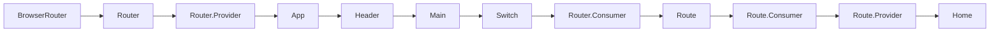

# 

**Learning objective:** By the end of this lesson, students will be able to create a context, and get and set the state within the context. 

### React Router Provider > Consumer Example

Another example of the Provider > Consumer model is `React Router`. 

For now just know that `React Router` uses the `Provider > Consumer` model which is visible in React DevTools.



Also another thing to note is that `React Router` creates and passes the following props using the `Provider > Consumer` model.

```js
// this is Home - props
{history: {…}, location: {…}, match: {…}, staticContext: undefined}
history: {length: 1, action: "POP", location: {…}, createHref: ƒ, push: ƒ, …}
location: {pathname: "/", search: "", hash: "", state: undefined}
match: {path: "/", url: "/", isExact: true, params: {…}}
```

---
## Working with React Context

Set up context in the parent Component and then consuming it in the child. In order to work with context we will need to do the following:

In the App Component:

*   import `createContext`
*   create and export an instance of `createContext`
*   set up a `context.Provider`
*   provide the data via the `context.Provider`

In the Child Components:

*   import the `useContext`
*   import the `context` from App
*   instantiate `useContext` to use the imported `context` from App

## App Component
---
### Importing and Using `createContext`

Before we can work with context we first need to import `createContext` from React.

```javascript
// App.jsx 
    
import React, { createContext } from "react";
          
// instantiate and export a new instance "createContext".
export const DataContext = createContext();
```
 
### Setting Up The Context Provider

The `Provider` is wrapped around the Components that we wish to provide the context. It requires a single prop called `value` which is assigned the data we wish the child Components to consume.

In this example we will pass the name and address that has been stored in state.

```javascript
// App.jsx
    
const UserComponent = () => {
    const [name, setName] = useState("")
    const [address, setAddress] = useState("")
    
    return (
	    <DataContext.Provider value={{name, address}}>
	        <UserComponent />
        </DataContext.Provider>
    )
}
    
export default App;
```

## Child Component
---

### Using The Context

The child Components will now consume the data. Consumers must first import "useContext" and the Context provided from the parent Component.

```javascript
// UserComponent.jsx
    
import React, { useContext } from "react";
import { DataContext } from "./App";
    
const UserComponent = () => {
	// setting up the context for use
	const dataContext = useContext(DataContext)
    
	return (
	    <>
			// using the context
			<div>name: {dataContext.name}</div>
			<div>address: {dataContext.address}</div>
        </>
    )
}
```

## The Full Codes

```javascript
// App.jsx

import React, { createContext, useState } from "react";
import UserComponent from "./UserComponent";

export const DataContext = createContext();

function App() {
	const [name, setName] = useState("Holmes");
	const [address, setAddress] = useState("221B Baker Street");

	return (
		<DataContext.Provider value={{ name, address }}>
			<UserComponent />
		</DataContext.Provider>
	);
}
      
export default App;
      
    
// UserComponent.jsx
    
import React, { useContext } from "react";
import { DataContext } from "./App";
    
const UserComponent = () => {
    const dataContext = useContext(DataContext);
    
    return (
		<>
			<div>name: {dataContext.name}</div>
			<div>address: {dataContext.address}</div>
		</>
    );
};
    
export default UserComponent;    
```
